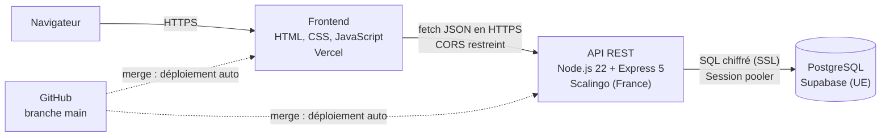

# Tickets YNOV : centre de support

Application web de suivi des demandes informatiques, réalisée pour le TP *Mise en production & Hébergement* (YNOV, 18 et 19 novembre 2026).
Les collaborateurs déclarent un incident, consultent les demandes existantes et suivent leur résolution.

## Liens

| | URL |
|---|---|
| Application (frontend) | https://tpmiseenprod.vercel.app |
| API (backend) | https://ticket-support.osc-fr1.scalingo.io |
| Santé de l'API | https://ticket-support.osc-fr1.scalingo.io/health |

## Architecture



| Tier | Rôle | Technologies | Hébergement |
|---|---|---|---|
| Présentation | Interface utilisateur | HTML, CSS, JavaScript sans framework | Vercel |
| Logique | API REST, validation, accès à la base | Node.js 22, Express 5, pg | Scalingo, région `osc-fr1` (France) |
| Données | Stockage persistant | PostgreSQL | Supabase, région `eu-west-1` (Irlande) |
| Code source | Versionnement, déclenche les déploiements | Git | GitHub |

Le frontend ne parle jamais directement à la base de données : il passe uniquement par l'API.
Seule l'API connaît l'URL de connexion à la base, stockée dans les variables d'environnement de Scalingo.

## Structure du dépôt

```
backend/
  src/index.js      point d'entrée : CORS, /health, gestion des erreurs
  src/tickets.js    routes /api/tickets
  src/db.js         connexion PostgreSQL (variable DATABASE_URL)
  schema.sql        création de la table tickets
  Procfile          commande de démarrage pour Scalingo
  .env.example      modèle de configuration, sans secret
frontend/
  index.html, styles.css, app.js
  config.js         URL publique de l'API
docs/
  compte-rendu.md   compte rendu technique
```

## API

| Méthode | Route | Rôle | Codes |
|---|---|---|---|
| GET | `/health` | Vérifie que l'API et la base répondent | 200, 503 |
| GET | `/api/tickets` | Liste les tickets, les plus récents d'abord | 200 |
| POST | `/api/tickets` | Crée un ticket : `{ "titre": "...", "description": "..." }` | 201, 400 |
| PATCH | `/api/tickets/:id` | Change le statut : `{ "statut": "en_cours" }` | 200, 400, 404 |

Les réponses sont en JSON. Les statuts possibles sont `ouvert`, `en_cours` et `resolu` : ils sont contrôlés par l'API et par une contrainte `CHECK` en base.

## Modèle de données

Table `tickets` (voir [backend/schema.sql](backend/schema.sql)) :

| Champ | Type | Description |
|---|---|---|
| `id` | `SERIAL` | Identifiant unique |
| `titre` | `TEXT NOT NULL` | Titre du ticket, non vide |
| `description` | `TEXT` | Description de la demande |
| `statut` | `TEXT` | `ouvert` (par défaut), `en_cours` ou `resolu` |
| `created_at` | `TIMESTAMPTZ` | Date de création, remplie automatiquement |

## Lancer le projet en local

Prérequis : Node.js 22.

**Backend**

```powershell
cd backend
Copy-Item .env.example .env   # puis renseigner DATABASE_URL dans .env
npm install
npm run dev                   # http://localhost:3000/health
```

**Frontend**

Servir le dossier `frontend/` avec un serveur statique, par exemple l'extension *Live Server* de VS Code.
Par défaut, le front appelle l'API en production. Pour utiliser l'API locale, cliquer sur l'indicateur de connexion en haut à droite et saisir `http://localhost:3000`.

## Déploiement

### Base de données : Supabase

1. Projet créé en Europe, avec la *Data API* désactivée et la RLS activée automatiquement sur les nouvelles tables.
2. Table créée en exécutant [backend/schema.sql](backend/schema.sql) dans le *SQL Editor*.
3. URL de connexion récupérée dans *Connect > Direct > Session pooler*. Le pooler est compatible IPv4, contrairement à la connexion directe.

### Backend : Scalingo

1. Application `ticket-support` créée dans la région `osc-fr1`.
2. Dépôt GitHub lié, avec déploiement automatique de la branche `main`.
3. Variables d'environnement (les valeurs secrètes ne sont pas reproduites ici) :

   | Variable | Contenu |
   |---|---|
   | `PROJECT_DIR` | `backend` : le code de l'API est dans un sous-dossier du dépôt |
   | `DATABASE_URL` | URL du Session pooler Supabase, mot de passe compris (secret) |
   | `CORS_ORIGIN` | `https://tpmiseenprod.vercel.app` |
   | `PORT` | Fourni automatiquement par Scalingo |

4. Le buildpack Node.js installe les dépendances (`npm install`), puis le `Procfile` lance `npm start`.
5. L'option *Force HTTPS* est activée : toute requête en `http://` est redirigée vers `https://`.

### Frontend : Vercel

1. Projet importé depuis GitHub, avec `frontend` comme *Root Directory*. Il n'y a pas d'étape de build : Vercel sert directement les fichiers statiques.
2. Branche de production : `main`.
3. L'URL de l'API est définie dans [frontend/config.js](frontend/config.js). Ce n'est pas un secret, puisque le navigateur l'utilise à chaque appel.

### Mise en production (CI/CD)

- Le travail se fait sur la branche `dev` ou sur une branche dédiée (`feat/...`).
- Une Pull Request de `dev` vers `main` correspond à une mise en production.
- Le merge sur `main` déclenche automatiquement un nouveau déploiement sur Vercel et sur Scalingo. Les autres branches obtiennent une URL de prévisualisation sur Vercel, sans toucher à la production.

## Sécurité

- Aucun secret dans le dépôt : `.env` est ignoré par Git et `.env.example` ne contient aucune vraie valeur.
- Le mot de passe de la base n'existe que dans les variables d'environnement de Scalingo.
- Côté Supabase, la *Data API* est désactivée et la RLS est activée : la table n'est accessible qu'au travers de notre API.
- L'API utilise des requêtes SQL paramétrées, valide toutes les données reçues et limite la taille des requêtes à 10 ko.
- Le CORS n'autorise que le site Vercel, et tout passe en HTTPS (*Force HTTPS* sur Scalingo, HTTPS natif sur Vercel).

## Documentation

- [Compte rendu technique](docs/compte-rendu.md) : choix d'hébergement, configurations, problèmes rencontrés et leurs solutions.
